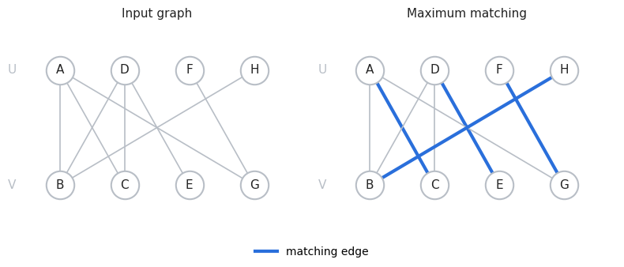
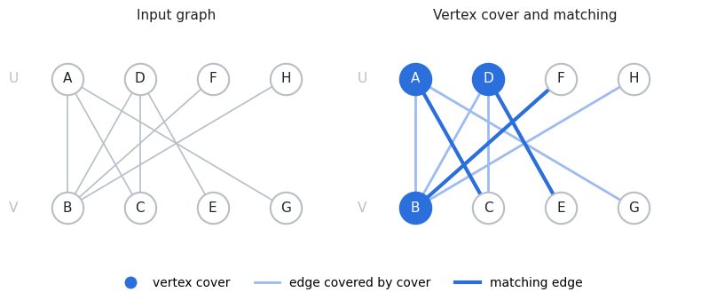

# Linear Optimisation Assignments

**Team: Sagar Parajuli [CS26BTKMU11003]**
------

## Assignment 1: Handwritten Simplex Algorithm Notes

---

## Assignment 2: Python Implementation of the Simplex Algorithm

### Linear Programming Problem and Test Results

#### 1. Example linear programming problem

Consider the following linear programming problem.

**Objective function**

Maximise
\[
z = 3x_1 + 5x_2
\]

**Subject to**
\[
\begin{aligned}
x_1 &\leq 4,\\
x_2 &\leq 6,\\
3x_1 + 2x_2 &\leq 18,\\
x_1 &\geq 0,\\
x_2 &\geq 0.
\end{aligned}
\]

#### Program output

```text
n = 2 variables, m = 5 constraints

Initial vertex
  x        = [4, 3]
  z        = 27
  feasible = True

Vertices visited
  iter vertex                z           tight rows
  0    [4, 3]                27          [1, 3]
  1    [2, 6]                36          [2, 3]

Result
  Optimal vertex: [2, 6]
  Optimal objective value: 36
```

The program starts at the feasible vertex \((4,3)\) and moves to \((2,6)\), where the objective function reaches its maximum value of \(36\).

Thus, the **optimal solution** is
\[
(x_1,x_2)=(2,6), \qquad z_{\max}=36.
\]

#### 2. Results for other test cases

The implementation was also evaluated on additional test cases covering different types of linear programming problems.

| Test case | Description | Status | Objective value (\(z\)) | Optimal vertex | Vertices visited |
|:--|:--|:--|--:|:--|--:|
| 1 | Unique optimum | Optimal | 36 | \([2,6]\) | 3 |
| 2 | Multiple optima | Optimal | 4 | \([1,3]\) | 3 |
| 3 | Infeasible | Infeasible | — | — | 0 |
| 4 | Unbounded | Unbounded | — | — | 1 |
| 5a | Degenerate, 2D | Optimal | 6 | \([2,2]\) | 3 |
| 5b | Degenerate, 3D, \(c=(0,0,1)\) | Optimal | 1 | \([0,0,1]\) | 1 |
| 5c | Degenerate, 3D, \(c=(1,1,0)\) | Optimal | 2 | \([1,1,0]\) | 2 |
| 6 | Redundant constraints | Optimal | 4 | \([2,2]\) | 3 |
| 7 | Negative data | Optimal | -4 | \([2,1]\) | 2 |
| 8 | Four variables | Optimal | 8 | \([1,1,0.5,0]\) | 4 |
| 8b | 40 random problems compared with SciPy | Optimal | — | — | — |
| 9a | Nearly tight constraint | Optimal | 2 | \([1,1]\) | 3 |
| 9b | Tiny step | Optimal | 1 | \([0,1]\) | 1 |

*Note:* A dash (—) indicates that the corresponding value was not reported or is not applicable.

**All 13 tests passed.**

---

## Assignment 3: Maximum Matching in a Bipartite Graph

### Input graph

```text
Vertices (8): A, B, C, D, E, F, G, H
Edges    (8): (A,B), (A,C), (B,D), (C,D), (D,E), (F,G), (A,G), (H,B)
```

### Matching graph



### 1. Simplex solution

```text
rank(A) = 8, n = 8

Variable order: y(A,B), y(A,C), y(B,D), y(C,D), y(D,E), y(F,G), y(A,G), y(H,B)
Initial vertex: [0, 1, 0, 0, 1, 1, 0, 1]

  iter  vertex                     objective z
  0     [0, 1, 0, 0, 1, 1, 0, 1]   4

Optimal vertex   : [0, 1, 0, 0, 1, 1, 0, 1]
Optimal objective: 4
Solver status    : optimal
```

### 2. LP and ILP solution

```text
LP solution
  y(A,B) = 0.0000
  y(A,C) = 1.0000
  y(B,D) = 0.0000
  y(C,D) = 0.0000
  y(D,E) = 1.0000
  y(F,G) = 1.0000
  y(A,G) = 0.0000
  y(H,B) = 1.0000
  LP objective = 4

Conversion to ILP solution
Threshold: 0.5

  variable      LP value    decision          binary
  y(A,B)        0.0000      0.0000 < 0.5      0
  y(A,C)        1.0000      1.0000 ≥ 0.5      1
  y(B,D)        0.0000      0.0000 < 0.5      0
  y(C,D)        0.0000      0.0000 < 0.5      0
  y(D,E)        1.0000      1.0000 ≥ 0.5      1
  y(F,G)        1.0000      1.0000 ≥ 0.5      1
  y(A,G)        0.0000      0.0000 < 0.5      0
  y(H,B)        1.0000      1.0000 ≥ 0.5      1

ILP solution (binary): [0, 1, 0, 0, 1, 1, 0, 1]
Selected edges       : (A,C), (D,E), (F,G), (H,B)
ILP objective value  : 4
```

### 3. Sanity tests

```text
LP solution is integral                                PASS
  Every selected edge belongs to the graph               PASS
  No two selected edges share an endpoint                PASS
  All variables are binary                               PASS
  Objective value equals number of selected edges        PASS
  Every vertex constraint is satisfied                   PASS
  ILP objective equals LP optimum                        PASS
```

### 4. Matching solution

```text
Vertex set     : {A, B, C, D, E, F, G, H}
Partition U    : {A, D, F, H}
Partition V    : {B, C, E, G}
Edge set       : (A,B), (A,C), (B,D), (C,D), (D,E), (F,G), (A,G), (H,B)
Matching edges : (A,C), (D,E), (F,G), (H,B)
Matching size  : 4
Matching is feasible: PASS
```

---

## Assignment 4: Minimum Vertex Cover and Maximum Matching in a Bipartite Graph

### Input graph

```text
Vertices (8): A, B, C, D, E, F, G, H
Edges    (8): (A,B), (A,C), (B,D), (C,D), (D,E), (F,B), (A,G), (H,B)
```


### 1. Bipartition

The graph is checked for bipartiteness using BFS.

```text
The graph is bipartite.
U = {A, D, F, H}
V = {B, C, E, G}
```

### 2. Minimum vertex cover: ILP formulation

The binary variable \(x_v\) indicates whether vertex \(v\) belongs to the vertex cover.

```text
Primal ILP (minimum vertex cover)
  Variables: x_i in {0,1} for every vertex i; x_i = 1 if i is in the cover

  minimise   z = x_A + x_B + x_C + x_D + x_E + x_F + x_G + x_H
  subject to
    x_A + x_B ≥ 1        (edge A-B)
    x_A + x_C ≥ 1        (edge A-C)
    x_B + x_D ≥ 1        (edge B-D)
    x_C + x_D ≥ 1        (edge C-D)
    x_D + x_E ≥ 1        (edge D-E)
    x_F + x_B ≥ 1        (edge F-B)
    x_A + x_G ≥ 1        (edge A-G)
    x_H + x_B ≥ 1        (edge H-B)
    x_i ∈ {0,1}  for i = A, B, C, D, E, F, G, H
```

### 3. Primal LP relaxation

The LP relaxation replaces the binary restrictions with \(0 \leq x_i \leq 1\).

```text
Primal LP relaxation
  minimise   z = x_A + x_B + x_C + x_D + x_E + x_F + x_G + x_H
  subject to
    x_A + x_B ≥ 1        (edge A-B)
    x_A + x_C ≥ 1        (edge A-C)
    x_B + x_D ≥ 1        (edge B-D)
    x_C + x_D ≥ 1        (edge C-D)
    x_D + x_E ≥ 1        (edge D-E)
    x_F + x_B ≥ 1        (edge F-B)
    x_A + x_G ≥ 1        (edge A-G)
    x_H + x_B ≥ 1        (edge H-B)
    x_i ≥ 0   for x_A, x_B, x_C, x_D, x_E, x_F, x_G, x_H
    x_i ≤ 1   for x_A, x_B, x_C, x_D, x_E, x_F, x_G, x_H

Simplex form: n = 8 variables, m = 24 constraints
```

### 4. Primal simplex solution

The geometric simplex method is used to solve the primal LP relaxation.

```text
Variable order: x_A, x_B, x_C, x_D, x_E, x_F, x_G, x_H
Initial vertex: [0, 1, 1, 0, 1, 0, 1, 0]

  iter  vertex                     objective z
  0     [0, 1, 1, 0, 1, 0, 1, 0]   4
  1     [1, 1, 0, 1, 0, 0, 0, 0]   3

Optimal vertex   : [1, 1, 0, 1, 0, 0, 0, 0]
Optimal objective: 3
Solver status    : optimal
```

### 5. LP-to-ILP conversion

The optimal LP solution is converted into a binary solution using the threshold \(0.5\).

```text
LP solution (primal)
  x_A = 1.0000
  x_B = 1.0000
  x_C = 0.0000
  x_D = 1.0000
  x_E = 0.0000
  x_F = 0.0000
  x_G = 0.0000
  x_H = 0.0000
  LP objective = 3

Conversion to ILP solution
Threshold: 0.5

  variable      LP value    decision          binary
  x_A           1.0000      1.0000 ≥ 0.5      1
  x_B           1.0000      1.0000 ≥ 0.5      1
  x_C           0.0000      0.0000 < 0.5      0
  x_D           1.0000      1.0000 ≥ 0.5      1
  x_E           0.0000      0.0000 < 0.5      0
  x_F           0.0000      0.0000 < 0.5      0
  x_G           0.0000      0.0000 < 0.5      0
  x_H           0.0000      0.0000 < 0.5      0

ILP solution (binary): [1, 1, 0, 1, 0, 0, 0, 0]
Selected vertices    : {A, B, D}
ILP objective value  : 3
```

### 6. Verification of the vertex cover

```text
LP solution is integral                                PASS
  Every edge has an endpoint in the cover                PASS
  All variables are binary                               PASS
  Objective value equals number of selected vertices     PASS
  ILP objective equals LP optimum                        PASS
```

### 7. Dual formulation: maximum matching

The dual of the relaxed minimum vertex cover LP is the fractional matching LP.

\[
\max w = \sum_{e \in E} y_e
\]

subject to
\[
\sum_{e \ni v} y_e \leq 1
\quad \forall v \in U \cup V,
\qquad
y_e \geq 0
\quad \forall e \in E.
\]

The dual LP printed by the program is:

```text
Dual LP (fractional matching)
  Variables: one y_e ≥ 0 for every edge e, from the edge constraints of the primal

  maximise   w = y(A,B) + y(A,C) + y(B,D) + y(C,D) + y(D,E) + y(F,B) + y(A,G) + y(H,B)
  subject to
    y(A,B) + y(A,C) + y(A,G) ≤ 1             (vertex A, from x_A)
    y(A,B) + y(B,D) + y(F,B) + y(H,B) ≤ 1    (vertex B, from x_B)
    y(A,C) + y(C,D) ≤ 1                      (vertex C, from x_C)
    y(B,D) + y(C,D) + y(D,E) ≤ 1             (vertex D, from x_D)
    y(D,E) ≤ 1                               (vertex E, from x_E)
    y(F,B) ≤ 1                               (vertex F, from x_F)
    y(A,G) ≤ 1                               (vertex G, from x_G)
    y(H,B) ≤ 1                               (vertex H, from x_H)
    y_e ≥ 0   for y(A,B), y(A,C), y(B,D), y(C,D), y(D,E), y(F,B), y(A,G), y(H,B)

Simplex form: n = 8 variables, m = 16 constraints, rank(A) = 8
```

### 8. Dual simplex solution

```text
Variable order: y(A,B), y(A,C), y(B,D), y(C,D), y(D,E), y(F,B), y(A,G), y(H,B)
Initial vertex: [0, 1, 0, 0, 1, 1, 0, 0]

  iter  vertex                     objective z
  0     [0, 1, 0, 0, 1, 1, 0, 0]   3

Optimal vertex   : [0, 1, 0, 0, 1, 1, 0, 0]
Optimal objective: 3
Solver status    : optimal
```

### 9. Dual-to-matching conversion

The optimal fractional matching is converted into a binary matching using the threshold \(0.5\).

```text
LP solution (dual)
  y(A,B) = 0.0000
  y(A,C) = 1.0000
  y(B,D) = 0.0000
  y(C,D) = 0.0000
  y(D,E) = 1.0000
  y(F,B) = 1.0000
  y(A,G) = 0.0000
  y(H,B) = 0.0000
  LP objective = 3

Conversion to matching
Threshold: 0.5

  variable      LP value    decision          binary
  y(A,B)        0.0000      0.0000 < 0.5      0
  y(A,C)        1.0000      1.0000 ≥ 0.5      1
  y(B,D)        0.0000      0.0000 < 0.5      0
  y(C,D)        0.0000      0.0000 < 0.5      0
  y(D,E)        1.0000      1.0000 ≥ 0.5      1
  y(F,B)        1.0000      1.0000 ≥ 0.5      1
  y(A,G)        0.0000      0.0000 < 0.5      0
  y(H,B)        0.0000      0.0000 < 0.5      0

Binary edge variables: [0, 1, 0, 0, 1, 1, 0, 0]
Selected edges       : (A,C), (D,E), (F,B)
Matching size        : 3
```

### 10. Verification of the matching

```text
LP solution is integral                                PASS
  Every selected edge belongs to the graph               PASS
  No two selected edges share an endpoint                PASS
  All variables are binary                               PASS
  Matching size equals sum of edge variables             PASS
  Matching size equals LP optimum                        PASS
```

### 11. Final verification

The primal and dual LP optima agree. The minimum vertex cover and maximum matching also have the same size, verifying König's theorem for this input graph.

```text
Quantity                          Value
--------------------------------------------
Primal LP optimum                 3
Dual LP optimum                   3
ILP minimum vertex cover size     3
Maximum matching size             3

  Primal LP optimum = Dual LP optimum                 PASS
  Minimum vertex cover size = Maximum matching size   PASS
  Vertex cover feasibility checks                     PASS
  Matching feasibility checks                         PASS

All verification checks passed.
```

### 12. Graph output

The notebook displays the input graph alongside the solution graph:
- Filled vertices represent the minimum vertex cover: \(\{A,B,D\}\).
- Highlighted edges represent the maximum matching: \((A,C)\), \((D,E)\), and \((F,B)\).

**Final result:** Minimum vertex cover size \(= 3\), and maximum matching size \(= 3\).

## Assignment 5: Hand written proof on primal optimal is equal to dual optimal

### Sincerely
**Sagar Parajuli** - cs26btkmu11003@iith.ac.in
Phone: +91 8977229196

